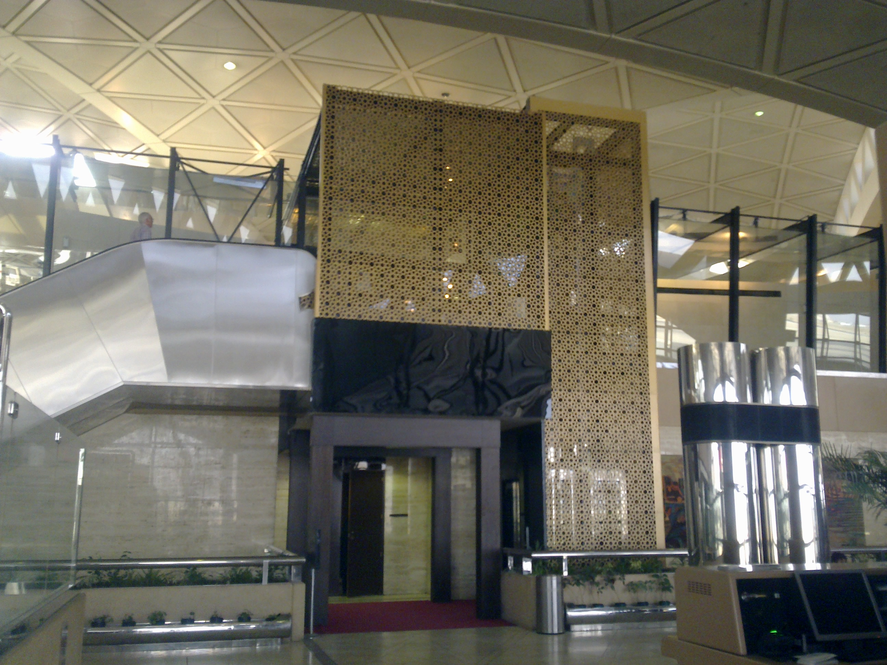

# Daily News FA | خبرهای روزانه فارسی

هر روز، خبرهای مهم روز قبل به زبان فارسی، با ذکر منبع.

Every day, the previous day's top news in Persian, with sources.

## آخرین خبرها | Latest

### [یکشنبه ۱۱ اکتبر ۲۰۲۶ (۱۹ مهر ۱۴۰۵)](2026-10-11.md)

*تصویر: فرودگاه ملک‌خالد ریاض، liton islam via Panoramio، CC BY 3.0 — [منبع در ویکی‌مدیا](https://commons.wikimedia.org/wiki/File:King_Khalid_International_Airport,_Riyadh_Saudi_Arabia_-_panoramio_(2).jpg)*

حمله دوم به فرودگاه ریاض (۱ کشته و ۱۱ زخمی؛ قربانیان شنبه به ۱۳ رسید) • ادعای ترامپ درباره «آتش‌بس انرژی» و پاسخ زلنسکی، بعد حمله روسیه به نیروگاه‌های کی‌یف و خارکیف • ایران پاسخ آمریکا را «ناکافی» خواند و کابل‌ها و دیتاسنترها را تهدید کرد؛ دو نفتکش در هرمز و دریای عمان هدف قرار گرفتند • ۵ کشته در غزه در یک‌سالگی آتش‌بس و شهادت دادستان سابق در دادگاه نتانیاهو

## برنامه‌نویسی و هوش مصنوعی | Dev & AI

### [یکشنبه ۱۱ اکتبر ۲۰۲۶](dev-ai-2026-10-11.md)

کانتکست ۵۰۰ هزاره GPT-6.1 Sol • مدل چندوجهی Clef-omni کلادفلر • پیش‌نمایش رایگان Odyssey-3 • مدل تصمیم Drex v1.5 • مبدل صوتی Humaneness از LAION • داغ HN و V2EX

## ساختار

- هر روز یک فایل: `YYYY-MM-DD.md` (به تاریخ میلادیِ روزی که خبرها مال آن است)
- مثال: `2026-09-27.md` = خبرهای یکشنبه ۲۷ سپتامبر ۲۰۲۶ (۵ مهر ۱۴۰۵)

## فهرست

- [2026-10-11](2026-10-11.md) — حمله دوم به فرودگاه ریاض (۱ کشته و ۱۱ زخمی)، ادعای «آتش‌بس انرژی» ترامپ و حمله به نیروگاه‌های اوکراین، پاسخ «ناکافی» ایران و دو نفتکش، ۵ کشته غزه
- [dev-ai-2026-10-11](dev-ai-2026-10-11.md) — برنامه‌نویسی و هوش مصنوعی: کانتکست ۵۰۰ هزاره GPT-6.1 Sol، ‏Clef-omni، پیش‌نمایش Odyssey-3، ‏Drex v1.5، مبدل صوتی LAION، بحث HN و V2EX
- [2026-10-10](2026-10-10.md) — حمله دوباره به فرودگاه ریاض (۱۲ کشته)، ۲۰ کشته زاپوریژیا و نشست میامی، تحریم دادگاه کیفری، تعویق انتخابات فلسطین، اعتراضات هند
- [dev-ai-2026-10-10](dev-ai-2026-10-10.md) — برنامه‌نویسی و هوش مصنوعی: Gemini 3.5 Flash، ‏Drex 1.5 و Decision-1، پیش‌نمایش Beam، مدل Unitree، بحث HN و V2EX
- [2026-10-09](2026-10-09.md) — نوبل صلح ناوی پیلای و تحریم دادگاه کیفری، ۷۸ کشته اوکراین و نشست میامی، اعتراضات فرانسه، غزه، تیراندازی نیویورک
- [dev-ai-2026-10-09](dev-ai-2026-10-09.md) — برنامه‌نویسی و هوش مصنوعی: Gemini 4 Argon، Mistral Large 4، Decision-1، FrogNano-4B، خرید Deno، بحث HN
- [2026-10-06](2026-10-06.md) — روز سراسری اعتراضات مدارس فرانسه، بلیتز ۶۵۰ پهپادی اوکراین به مسکو، غرق‌شدن کشتی ترکیه در دریای سیاه، ۲ کشته در غزه، باب‌المندب، موج حملات هرمز
- [dev-ai-2026-10-06](dev-ai-2026-10-06.md) — برنامه‌نویسی و هوش مصنوعی: مدل Beam، برق هسته‌ای گوگل، ۶۰ میلیارد آنتروپیک و ۱۲ میلیارد دیپ‌سیک، هک بانک‌های کره، بحث HN
- [2026-10-05](2026-10-05.md) — خارکیف زیر بمب‌های سرشی، سومین سالگرد ۷ اکتبر، باب‌المندب، خروج B-1ها از فیرفورد، تعطیلی مدارس فرانسه، نوبل پزشکی
- [dev-ai-2026-10-05](dev-ai-2026-10-05.md) — برنامه‌نویسی و هوش مصنوعی: واترمارک textGrain، مدل Beam، ایجنت‌های Dots، تبلیغات ChatGPT، بحث HN
- [2026-10-04](2026-10-04.md) — پل شمالی کی‌یف و سفر مرتس، نشست سه‌جانبه، بن‌بست ایران، یمن، سالگرد غزه، فرودگاه مکله، سیل کاتالونیا
- [dev-ai-2026-10-04](dev-ai-2026-10-04.md) — برنامه‌نویسی و هوش مصنوعی: آلتمن و «چیزهای بد»، فریز بانتی گوگل، Argon در HN، بحث HN
- [2026-10-03](2026-10-03.md) — حمله ادعایی حوثی‌ها به آرامکو نزدیک ریاض، آزادسازی ۱۰۰ میلیون بشکه نفت G7، حمله کمک‌خلبان فلای‌دوبی، ورود به مِکِله، آماده‌باش ایران، اعتراضات فرانسه، تورم ۳٫۸٪ یورو
- [dev-ai-2026-10-03](dev-ai-2026-10-03.md) — برنامه‌نویسی و هوش مصنوعی: استعفای مسئول ایمنی OpenAI، آلتمن و «نیروی دینی» مدل‌ها، سیستم Mods برای Claude Code، بحث V2EX
- [2026-10-02](2026-10-02.md) — حمله روسیه به شبکه برق اوکراین، خلبان فلای‌دوبی، طلای هاکی زنان هند، ریال در کف تاریخی، غزه ۷۴ هزار، توافق آمریکا و هند
- [dev-ai-2026-10-02](dev-ai-2026-10-02.md) — برنامه‌نویسی و هوش مصنوعی: دسترسی زودهنگام Argon، مدل Praxis-1، مدل Clef، نشست کاخ سفید، بحث HN و V2EX
- [2026-10-01](2026-10-01.md) — قطع روابط اتیوپی و اریتره، حملات پاکستان به افغانستان، تعلیق کتائب حزب‌الله، بازداشت فیرفورد، آزادی زندانیان بریتانیا، پرتاب Crew-13
- [dev-ai-2026-10-01](dev-ai-2026-10-01.md) — برنامه‌نویسی و هوش مصنوعی: عرضه Gemini 4 Argon، آواتار Dots، خرید World Labs، جذب Instinct، بحث HN و V2EX
- [2026-09-29](2026-09-29.md) — مذاکرات غیرمستقیم آمریکا و ایران و طرح هرمز، پس‌لرزه فیرفورد، حمله روسیه و پهپاد لهستان، Sol و Astra، تگزاس، موصل، تحریم ۱۰ نهاد
- [dev-ai-2026-09-29](dev-ai-2026-09-29.md) — برنامه‌نویسی و هوش مصنوعی: عرضه Sol، لغو Astra، عذرخواهی استرالیا، توقف آموزش، بحث V2EX
- [2026-09-28](2026-09-28.md) — حمله پهپادی به کی‌یف، مذاکرات آمریکا و ایران، بازداشت‌های فیرفورد، غزه ۷۴ هزار، لغو Astra، مادرید، لوردس، سنای فرانسه، ابولا
- [dev-ai-2026-09-28](dev-ai-2026-09-28.md) — برنامه‌نویسی و هوش مصنوعی: لغو Astra، گزارش‌های ناهمراستایی، ده‌ها هزار حادثه، بحث V2EX
- [2026-09-27](2026-09-27.md) — تنگه هرمز، صربستان، انفجار آتن، دیدار ترامپ-شی، هشدار پاپ درباره هوش مصنوعی، کمک نظامی اتحادیه اروپا به اوکراین، توقف آموزش OpenAI، هشدار بیل گیتس
- [dev-ai-2026-09-27](dev-ai-2026-09-27.md) — برنامه‌نویسی و هوش مصنوعی: مدل‌ها، ابزارها، بحث‌های کامیونیتی
